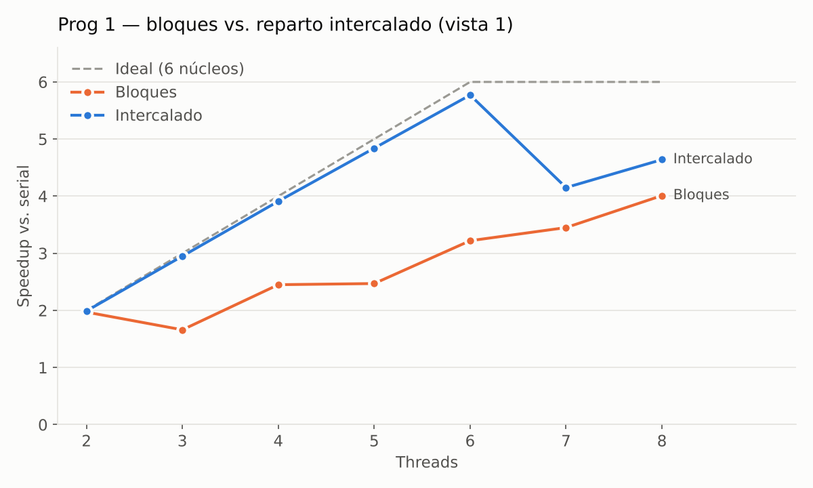

# CS149 — Assignment 1: Writeup

## Program 1: Mandelbrot con threads

**Hardware:** Intel i5-8400 (6 núcleos, 6 threads, sin hyperthreading), WSL2 Ubuntu 24.04, g++ 13.
**Tiempo serial de referencia:** ~470 ms (vista 1).

### 1. Reparto por bloques de filas

La primera versión divide la imagen (1200 filas) en `numThreads` bloques de filas consecutivas. Cada thread llama a `mandelbrotSerial()` con su `startRow` y `numRows`, recorriendo todo el ancho de la imagen. El último thread se lleva las filas sobrantes cuando `height` no es divisible por `numThreads`.

| Threads | 2 | 3 | 4 | 5 | 6 | 7 | 8 |
|---|---|---|---|---|---|---|---|
| Speedup (bloques, vista 1) | 1.97x | **1.66x** | 2.45x | 2.47x | 3.22x | 3.45x | 4.01x |

El speedup está lejos de ser lineal, y con 3 threads es **peor que con 2**.

**Por qué:** el costo de cada píxel depende de cuántas iteraciones tarda en escaparse. Los píxeles dentro del conjunto (la zona blanca) llegan al máximo de 256 iteraciones, mientras que los del borde negro se escapan en 1 o 2. Con 3 bloques, el thread del medio recibe casi toda la zona blanca. Midiendo el tiempo de cada thread con `CycleTimer`:


| | Thread 0 | Thread 1 | Thread 2 |
|---|---|---|---|
| Bloques | 95 ms | **291 ms** | 95 ms |

El tiempo total lo determina el thread más lento:

$$\text{speedup} \approx \frac{T_{\text{serial}}}{\max_k T_k} = \frac{470}{291} \approx 1.62$$

que coincide con el 1.66x medido. El trabajo total no cambió ($95 + 291 + 95 \approx 481$ ms); lo que falla es cómo está repartido. Los threads 0 y 2 tardan lo mismo porque el fractal es simétrico respecto del eje real, y por la misma razón 2 threads dan un speedup casi perfecto: cada mitad tiene exactamente el mismo trabajo.

### 2. Reparto intercalado (en rueda)

Para balancear la carga, cada thread toma una fila de cada `numThreads`, empezando por su `threadId`. Con 3 threads, el thread 0 hace las filas 0, 3, 6, …, el thread 1 las filas 1, 4, 7, …, y así. Como las filas vecinas cuestan parecido, cada thread recibe una mezcla equivalente de filas caras y baratas.

```cpp
for (int row = myId; row < height; row += numThreads) {
    mandelbrotSerial(args->x0, args->y0, args->x1, args->y1,
                     args->width, args->height,
                     row, 1,
                     args->maxIterations, args->output);
}
```

Con 3 threads, los tres tardan ~161 ms, justo el reparto perfecto ($481 / 3 \approx 160$ ms).



| Threads | 2 | 3 | 4 | 5 | 6 | 7 | 8 |
|---|---|---|---|---|---|---|---|
| Bloques (vista 1) | 1.97x | 1.66x | 2.45x | 2.47x | 3.22x | 3.45x | 4.01x |
| Intercalado (vista 1) | 1.99x | 2.95x | 3.91x | 4.84x | 5.77x | 4.15x | 4.64x |
| Intercalado (vista 2) | 1.96x | 2.96x | 3.89x | 4.83x | 5.78x | 4.29x | 4.29x |

Hasta 6 threads el speedup es casi lineal (en la mejor corrida, 5.97x con 6 threads). Además, las dos vistas escalan prácticamente igual: con el reparto intercalado, el speedup no depende de dónde esté el trabajo caro dentro de la imagen.


Entre corridas hay una variación de ±0.2x (por ejemplo, 5.77x vs. 5.97x con 6 threads), atribuible a otros procesos de Windows y WSL2 compitiendo por los núcleos.

### 3. Más threads que núcleos

Con 7 y 8 threads el speedup **cae** respecto de 6, en las dos vistas. El i5-8400 tiene 6 núcleos sin hyperthreading, así que con 7 threads algún núcleo tiene que alternar entre dos threads y termina último. Si los threads quedaran fijos en sus núcleos, el núcleo más cargado tendría $\lceil n/6 \rceil$ threads de $W/n$ trabajo cada uno:

$$\text{speedup} \approx \frac{n}{\lceil n/6 \rceil}$$

| Threads | Modelo | Medido |
|---|---|---|
| 6 | 6.0 | 5.77–5.97 |
| 7 | 3.5 | 4.15–4.41 |
| 8 | 4.0 | 4.55–4.64 |
| 12 | 6.0 | 5.29 |

Lo medido queda por encima del modelo con 7 y 8 threads porque Linux migra threads entre núcleos a medida que se liberan, y eso recupera parte de la pérdida. Con 12 threads (múltiplo de 6) el speedup vuelve a subir, como predice el modelo, aunque no llega a 6 por el costo de los cambios de contexto y la competencia con los procesos de Windows.

En las máquinas myth (4 núcleos con 2 hyperthreads cada uno) el comportamiento es distinto: los threads 5 a 8 corren en hyperthreads, que comparten las unidades de ejecución del núcleo, y aportan menos que un núcleo completo.

Con el reparto por bloques, en cambio, 7 y 8 threads **mejoraban** el speedup: ahí el problema dominante era el desbalance, y más bloques más chicos lo reducían.

### Conclusión

- **El reparto importa más que la cantidad de threads.** Con bloques de filas, agregar threads no garantiza más speedup: con 3 threads cayó a 1.66x (peor que con 2), porque el bloque central concentra casi todo el trabajo y el tiempo total lo marca el thread más lento. Con el reparto intercalado, el speedup es casi lineal hasta 6 threads (≈5.8–6x) en ambas vistas.

- **El límite es la cantidad de núcleos.** Con más threads que núcleos el speedup cae: con 7 threads, algún núcleo tiene que alternar entre dos y termina último. El speedup se recupera parcialmente cuando la cantidad de threads es múltiplo de los núcleos (12 threads → 5.29x).

- **El reparto intercalado funciona porque filas vecinas cuestan parecido.** Al alternarlas, cada thread recibe una mezcla equivalente de filas caras y baratas. Si el costo variara de forma impredecible, un reparto estático podría quedar desbalanceado igual; en ese caso convendría un reparto dinámico (una cola de filas compartida de la que cada thread toma la siguiente al terminar).

---

## Program 2: Vectorización con intrinsics SIMD (simulados)

Este programa usa los intrinsics simulados de `CS149intrin.h`, que modelan registros vectoriales de `VECTOR_WIDTH` lanes y cuentan cada instrucción vectorial ejecutada (cada una se asume de 1 ciclo). No hay mediciones de tiempo real: las métricas son la cantidad total de instrucciones y la **utilización vectorial** (el porcentaje de lanes activos sobre el total).

### 1. `clampedExpVector`

La función serial eleva cada `values[i]` a `exponents[i]` y recorta el resultado en 9.999999. Para vectorizarla, cada estructura de control del código serial se convierte en una **máscara** (un bit por lane que indica qué lanes ejecutan cada instrucción):

| Código serial | Versión vectorial |
|---|---|
| `i < N` | `maskAll`: en la última vuelta solo activa los lanes que existen (`_cs149_init_ones(min(VECTOR_WIDTH, N - i))`) |
| `if (y == 0)` | `maskIsZero = (y == 0)`, con `veq_int` |
| `else` | `maskIsNotZero = !maskIsZero && maskAll` |
| `while (count > 0)` | `maskActive = (count > 0)`, recalculada en cada vuelta; el loop sigue mientras `cntbits(maskActive) > 0` |
| `if (result > 9.999999f)` | `maskIsGreaterThan = (result > 9.999999)` |

```cpp
_cs149_vgt_int(maskActive, count, zeroInt, maskIsNotZero);
while (_cs149_cntbits(maskActive) > 0) {
    _cs149_vmult_float(result, result, x, maskActive);
    _cs149_vsub_int(count, count, oneInt, maskActive);
    _cs149_vgt_int(maskActive, count, zeroInt, maskActive);
}
```

Dos detalles que causaron errores durante la implementación:

- **Las comparaciones con máscara solo escriben en los lanes activos**; los demás conservan su valor anterior. Por eso `maskIsZero` y `maskActive` se inicializan en cero al principio de cada vuelta: si no, los lanes no comparados pueden quedar con basura y entrar al `while`.
- **Los lanes que no existen** (cuando `N` no es múltiplo de `VECTOR_WIDTH`) tienen que excluirse de todas las máscaras, no solo de los `load`/`store`. Si no, entran al `else` con un exponente basura y el `while` puede dar vueltas de más.

La implementación pasa para cualquier `N`, incluido `N = 3` con `VECTOR_WIDTH = 4`.

### 2. Utilización según `VECTOR_WIDTH` (N = 10000)


| `VECTOR_WIDTH` | Instrucciones | Utilización | Reducción vs. ancho 2 | Ideal |
|---|---|---|---|---|
| 2 | 167 729 | 77.9% | 1.00x | 1x |
| 4 | 97 077 | 70.7% | 1.73x | 2x |
| 8 | 52 879 | 67.0% | 3.17x | 4x |
| 16 | 27 594 | 65.2% | 6.08x | 8x |

**La utilización baja a medida que crece el ancho del vector.** La causa es la **divergencia** en el `while`: todos los lanes ejecutan la misma instrucción, así que un vector no puede avanzar al siguiente grupo de elementos hasta que termine su lane más lento. Las vueltas que da cada grupo son

$$\text{vueltas del grupo} = \max_{k \in \text{grupo}} (y_k - 1)$$

mientras que el trabajo útil depende del promedio de los exponentes. Los lanes que terminan antes quedan con la máscara en 0 y su ALU recibe instrucciones sin hacer nada útil. Cuanto más ancho es el vector, más probable es que el grupo contenga un exponente grande, y más lanes quedan esperando.

**La caída se va frenando** (−7.2, −3.7 y −1.8 puntos) porque los exponentes tienen un tope: con grupos grandes, el máximo del grupo ya está casi siempre cerca del exponente máximo, y agrandar el grupo no lo empeora mucho más.

Aun así, **vectores más anchos ejecutan muchas menos instrucciones en total**: con ancho 16 se ejecutan 6.08x menos instrucciones que con ancho 2. Baja la eficiencia por lane, pero el rendimiento total sigue subiendo. La diferencia entre la reducción real y la ideal es justamente la utilización perdida.

**Posible mejora:** con exponenciación por cuadrados ($x^9 = ((x^2)^2)^2 \cdot x$), el loop pasa de hasta $y - 1$ vueltas a $\lceil \log_2 y \rceil$, lo que reduce tanto el trabajo como la diferencia entre lanes rápidos y lentos.

### 3. Extra: `arraySumVector`

La suma se hace en dos fases:

1. **Acumulación:** un vector `sum` acumula de a `VECTOR_WIDTH` elementos, así que cada lane guarda la suma parcial de "su columna" del array. Son $N / W$ instrucciones `vadd`.
2. **Reducción:** las $W$ sumas parciales se combinan en $\log_2 W$ rondas de `hadd` (suma pares de lanes vecinos) + `interleave` (pone los lanes pares primero y los impares después, para que las sumas a combinar queden vecinas en la ronda siguiente).

```
[ 1 | 2 | 3 | 4 ]
hadd       → [ 3 | 3 | 7 | 7 ]
interleave → [ 3 | 7 | 3 | 7 ]
hadd       → [ 10 | 10 | 10 | 10 ]
```

```cpp
for (int w = VECTOR_WIDTH; w > 1; w /= 2) {
    _cs149_hadd_float(sum, sum);
    _cs149_interleave_float(sum, sum);
}
float out[VECTOR_WIDTH];
_cs149_vstore_float(out, sum, maskAll);
return out[0];
```

El costo total es del orden de $N/W + 2\log_2 W$ instrucciones, dentro del objetivo del enunciado ($N/W + \log_2 W$, a menos de una constante). Pasa para `VECTOR_WIDTH` de 2, 4, 8 y 16.